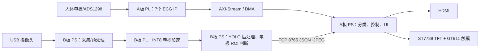

# 项目总览

## 项目定位

PulseAtlas 是一套基于两块 PYNQ-Z2（Zynq-7020）的多导联心电采集、分析和视觉贴片引导原型。系统把高确定性、强流水的任务放入 FPGA PL，把控制、模型后处理、显示与网络放入 ARM PS，通过双板分工缓解单片 XC7Z020 的 BRAM/DSP 约束。

## 总体数据流

## 关键技术点

1. **A 板 7 IP 心电流水线**：采集、质量、滤波、QRS、小波、12 导联、数据打包均有独立 PL 模块，以 AXI-Stream 串接。
2. **ECG 1D-ResNet**：输入 12×5000（500 Hz、10 秒），输出 NORM、MI、STTC、CD、HYP 五个独立概率。
3. **B 板视觉专用化**：YOLO11n-pose 使用 256×192 输入和 INT8 卷积核，PL 侧计算 96 个卷积节点，PS 侧完成其余图算子、解码、投影与网络传输。
4. **固定位置电极判断**：姿态/标定结果产生 10 个 96×96 ROI，小型二分类网络判断“贴片/非贴片”，再叠加颜色分组和 2-of-3 时序门控。
5. **双显示与无触控备份控制**：HDMI 与横屏 TFT 共用 UI 语义；GT911 触摸和板载按键均可操作；SW0 控制 TFT 单屏或 HDMI+TFT 模式。

## 工程价值

- 展示 Zynq PS/PL 协同在生物电信号处理和视觉推理中的两类典型用法。
- 从传感器、实时信号链、神经网络、视觉引导、网络协同到 UI 形成完整闭环。
- 保存了 C 仿真、C/RTL 协同仿真、Vivado 时序/资源和板端实测证据，便于复现与审查。
