# B 板技术说明

## 模型与数据流

```mermaid
flowchart LR
    CAM[USB Camera] --> CAP[PS: V4L2/OpenCV采集]
    CAP --> PRE[PS: resize/letterbox/INT8量化]
    PRE --> DMA[连续内存/AXI DMA]
    DMA --> PL[PL: vision_conv_writebase_v19]
    PL --> OPS[PS: 非卷积图算子与YOLO解码]
    OPS --> CAL[标定投影与10个ROI]
    CAL --> PATCH[10×96×96贴片存在模型]
    PATCH --> HSV[HSV颜色+2/3时序门控]
    HSV --> NET[TCP JSON+JPEG到A板]
```

## 姿态模型

- 主干：YOLO11n-pose。
- 固定输入：256×192。
- 量化：INT8 激活/权重，逐层量化参数由 PS 调度。
- 计算规模：约 444,268,128 MAC/帧。
- 最新图包含 96 个卷积节点；PL 负责卷积主计算，PS 负责拼接、上采样、激活/重定量、输出解码等图算子。

## PL 卷积核

- 核心源码：`vision_conv_writebase_v19.cpp`。
- 支持普通卷积和 depthwise 路径，采用 INT8 输入/权重与更宽累加器。
- 通过 AXI 主接口访问连续缓冲区，PS 预先分配和复用 BO，减少重复分配与缓存同步。
- R14 将请求的 95 MHz 映射为 90.909 MHz并收敛；R16 depthwise 版本进一步提高专用路径效率。
- R19 移除该板卡 XRT 非缓存 BO 上的冗余输入/输出同步，96 个中间张量和 3 个最终输出保持逐位一致。

## 电极检测

姿态/标定确定十个预计贴片位置后，各裁剪一个 96×96 ROI。小型二分类模型只判断“有贴片/无贴片”，不直接识别 RA/LA/V1-V6；电极身份由 ROI 的固定位置决定。再以 HSV/颜色组检查辅助发现明显颜色不匹配，并用最近 3 次结果中至少 2 次命中才置绿，降低光照变化和单帧误触发。

## 资源与时序

- 总 LUT：32,460 / 53,200（约 61.0%）
- FF：32,989 / 106,400（约 31.0%）
- BRAM：106×RAMB36 + 24×RAMB18，折合 118 / 140（约 84.3%）
- DSP：196 / 220（约 89.1%）
- WNS：+0.266 ns；WHS：+0.008 ns；TNS/THS：0
